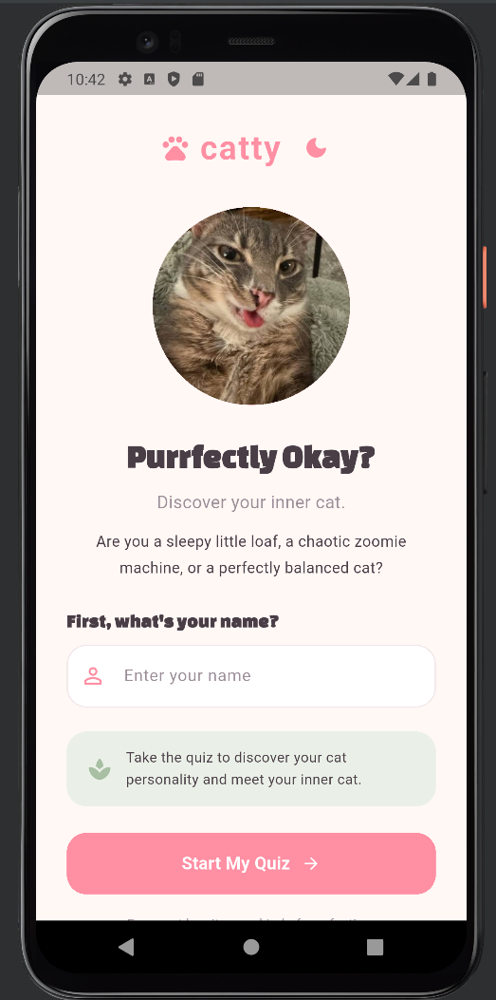
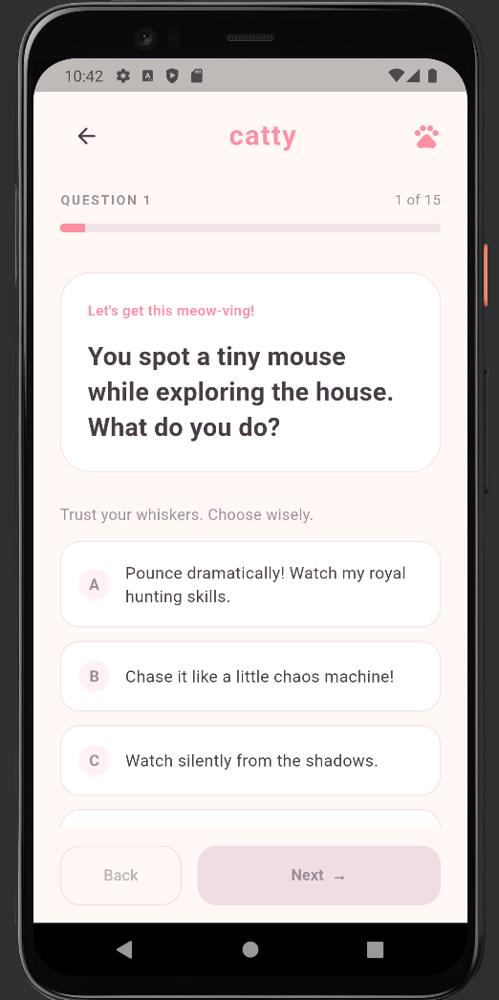
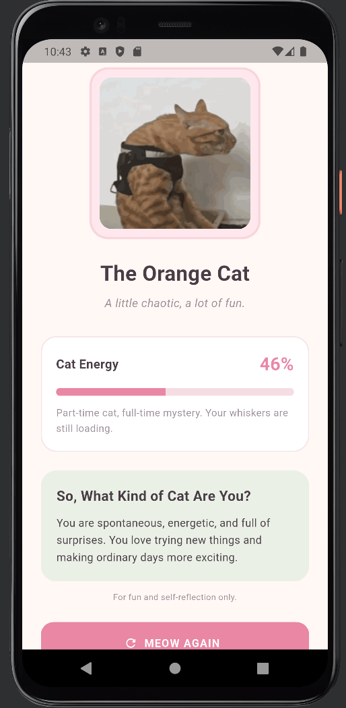
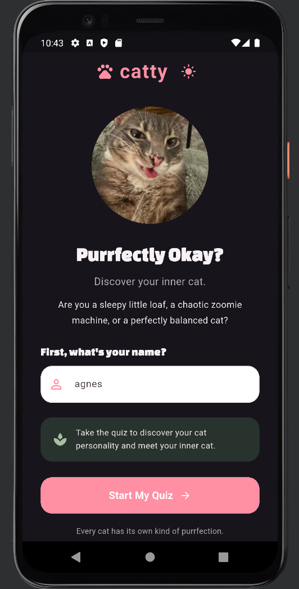
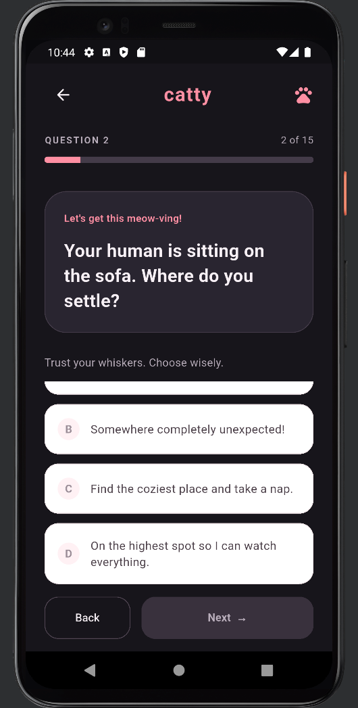
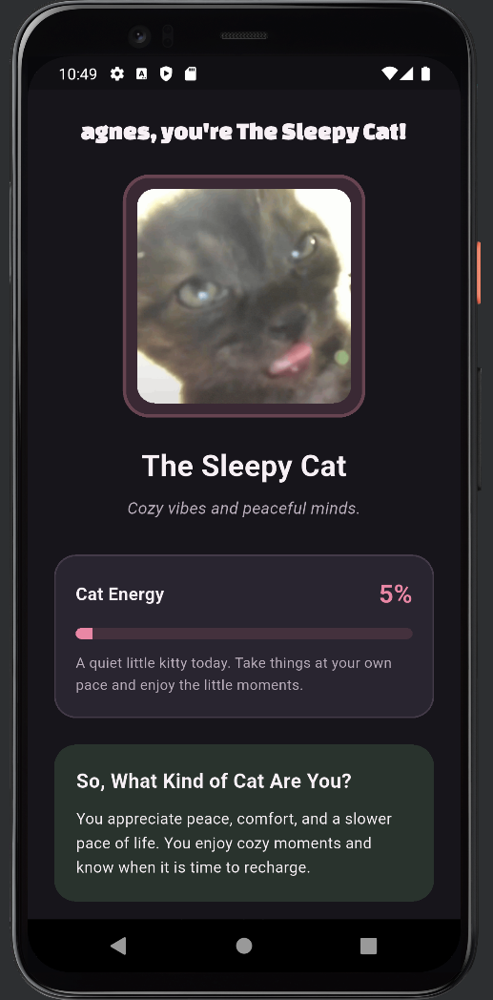

# Catty: Purrfectly Okay?

## 1. Identitas Mahasiswa

- **Nama:** Agnes Refaya Agustine Silalahi
- **NIM:** 241401125
- **Lab:** lab 4

## 2. Informasi Aplikasi

### Nama Aplikasi
**Catty: Purrfectly Okay?**

### Deskripsi Aplikasi
Catty adalah aplikasi kuis interaktif berbasis Flutter yang dirancang untuk mengetahui kepribadian kucing yang paling sesuai dengan pengguna berdasarkan jawaban dari serangkaian pertanyaan. Aplikasi ini memiliki tampilan yang minimalis dengan perpaduan warna pastel pink dan sage green, serta mendukung mode terang dan mode gelap.

### Fitur-Fitur Aplikasi

- **Personality Quiz:** Kuis interaktif yang terdiri dari 15 pertanyaan.
- **Five Cat Personalities:** Menampilkan lima tipe kepribadian kucing, yaitu Princess Cat, Orange Cat, Black Cat, Sleepy Cat, dan Curious Cat.
- **Personalized Results:** Menentukan hasil kepribadian berdasarkan jawaban pengguna.
- **Energy Score:** Menampilkan skor energi berdasarkan hasil kuis.
- **Retake Quiz:** Memungkinkan pengguna mengulang kuis.
- **Dark Mode:** Mendukung mode terang dan mode gelap.
- **Responsive UI:** Tampilan yang dirancang agar nyaman digunakan pada berbagai ukuran layar.

## 3. Dokumentasi

### A. Asset Credits

#### 1. Cat Personality GIFs

- **Black Cat:** [Tenor – Shake My Hand](https://tenor.com/view/shake-my-hand-shake-hand-shake-hands-ai-cat-clapping-hands-gif-15036103406822974936)
- **Curious Cat:** [Tenor – Issue Cat](https://tenor.com/view/issue-cat-waltuh-memes-gif-4271048792259434983)
- **Princess Cat:** [Tenor – Marie Sassy](https://tenor.com/view/marie-sassy-aristocats-cat-gif-10231732)
- **Orange Cat:** [Tenor – Goofy Cat](https://tenor.com/view/goofy-tiktok-bakekok-cukurukuk-kucing-gif-3119107954412383941)
- **Sleepy Cat:** [Tenor – Eepy Cat](https://tenor.com/view/eepy-cat-cat-sleepy-cat-dozing-off-gif-632841916357103912)

#### 2. Icons and Images

- **Rigby Image/Icon:** [Instagram post](https://www.instagram.com/p/DGWkyviP34S/)

#### 3. Fonts

- **Changa One:** [Google Fonts](https://fonts.google.com/specimen/Changa+One?preview.script=Latn)

### B. Screenshots

### 1. Home Screen



### 2. Quiz Screen



### 3. Result Screen



### 4. Home Screen - Dark Mode



### 5. Quiz Screen - Dark Mode



### 6. Result Screen - Dark Mode



### C. Mockup/Prototype Aplikasi

- **Figma Make Prototype:** [Catty – Find Your Cat Personality](https://www.figma.com/make/W8xOs5c5sHsUOkwpMppX6B/Review-Attached-Content?t=HNPUYp7u4yIZpHgw-20&fullscreen=1)

## 4. Teknologi yang Digunakan

- Flutter
- Dart
- Provider (State Management)

## 5. Cara Menjalankan Aplikasi

1. Clone repository ini:
   ```bash
   git clone https://github.com/agnesrefayas-sketch/catty.git
   ```
2. Masuk ke folder proyek:
   ```bash
   cd catty
   ```
3. Install dependencies:
   ```bash
   flutter pub get
   ```
4. Jalankan aplikasi:
   ```bash
   flutter run
   ```